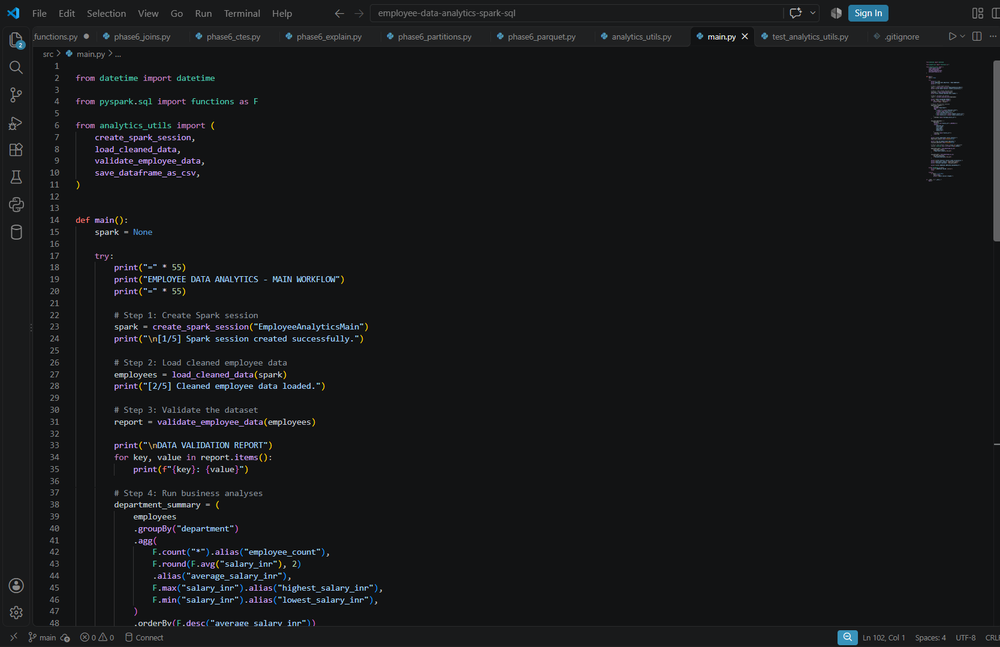
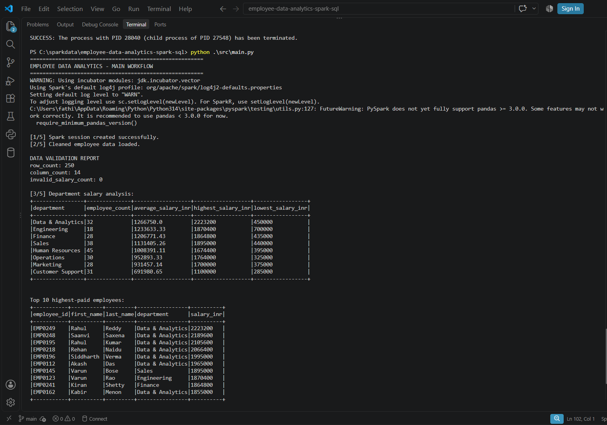
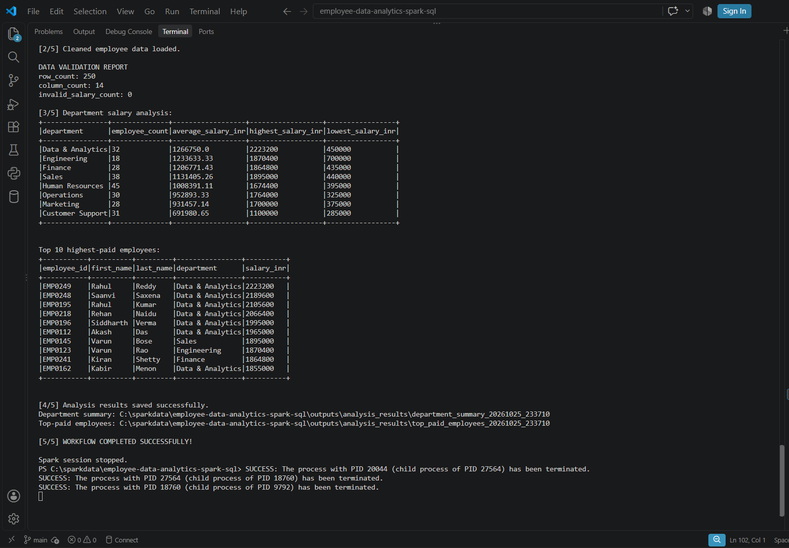

# Employee Data Analytics Using Apache Spark SQL

## Project Overview

This project uses **Apache Spark SQL and PySpark** to analyze a fictional employee dataset and discover insights about salaries, departments, work experience, performance ratings, and bonuses.

It demonstrates an end-to-end Big Data analytics workflow, covering data exploration, data cleaning, business analysis, advanced SQL techniques, query execution plans, and data storage.

The project was developed to gain practical experience with Apache Spark and build a portfolio project demonstrating data analytics and Big Data processing skills.

## Business Problem

Organizations need to understand employee compensation, workforce distribution, experience levels, and performance-related metrics to make informed business decisions.

This project demonstrates how structured employee data can be processed and analyzed using Apache Spark SQL to answer business questions and identify workforce patterns.

## Project Objectives

- Load and explore employee data using Apache Spark.
- Identify missing values, duplicate records, and potential data-quality issues.
- Analyze salary distributions across departments and job titles.
- Investigate salary patterns across experience levels.
- Examine employee performance ratings, bonuses, and workforce characteristics.
- Apply joins, Common Table Expressions (CTEs), and window functions.
- Explore query execution plans, partitioning strategies, and Parquet storage.
- Build a reusable analytics workflow that validates data and saves results.
- Manage project source code and documentation using Git and GitHub.

## Dataset

The project uses a dataset containing **250 fictional employee records and 14 columns**.

The dataset includes the following information:

| Category | Fields |
|---|---|
| Employee details | Employee ID, first name, last name |
| Job information | Department, job title, employment type |
| Work information | Location, hire date, manager ID |
| Compensation | Salary in INR, bonus percentage |
| Employee profile | Years of experience, education level |
| Performance | Performance rating |

**Data privacy note:** The dataset contains fictional data for educational and portfolio purposes. It does not represent actual employees or a real organization's payroll.

## Tools and Technologies

- **Programming language:** Python
- **Big Data processing:** Apache Spark, PySpark
- **Query language:** Spark SQL
- **Data formats:** CSV and Parquet
- **Development environment:** Visual Studio Code
- **Version control:** Git and GitHub

## Project Structure

```text
employee-data-analytics-spark-sql/
├── data/
│   ├── employee_analytics_dataset.csv
│   └── README.md
├── outputs/
│   └── Generated analysis results
├── screenshots/
│   └── Project execution screenshots
├── src/
│   ├── employee_analysis.py
│   ├── phase3_data_cleaning.py
│   ├── phase4_business_questions.py
│   ├── phase5_window_functions.py
│   ├── phase6_ctes.py
│   ├── phase6_explain.py
│   ├── phase6_joins.py
│   ├── phase6_parquet.py
│   ├── phase6_partitions.py
│   ├── analytics_utils.py
│   ├── test_analytics_utils.py
│   └── main.py
├── .gitignore
└── README.md
```

Generated output directories are excluded from version control. They are created locally when the relevant scripts run.

## Implementation and Features

### Phase 1: Spark SQL Fundamentals

- Load employee data and inspect the dataset.
- Create temporary views for SQL queries.
- Practice `SELECT`, `WHERE`, and `LIMIT`.
- Calculate average, maximum, and minimum values.

### Phase 2: Employee Salary Analysis

- Analyze employee salary distributions.
- Group employees by department and other categories.
- Compare salary statistics across departments.
- Apply filtering, sorting, and aggregation techniques.

### Phase 3: Data Cleaning and Quality Validation

- Inspect missing values and duplicate records.
- Normalize text fields and handle blank values.
- Convert hire dates into a date data type.
- Validate salary, experience, bonus, and manager references.
- Save cleaned employee data in Parquet format.

Missing values are reported and handled according to the implemented cleaning logic. Not every missing value is automatically removed.

### Phase 4: Business Analysis

- Analyze average, minimum, maximum, and total salaries.
- Examine workforce distribution across departments and job titles.
- Investigate experience, education, performance ratings, and bonuses.
- Compare individual salaries with department-level averages.
- Analyze employee distribution by employment type and location.

### Phase 5: Window Functions

- Apply `ROW_NUMBER()`, `RANK()`, and `DENSE_RANK()`.
- Compare employee salaries using `LAG()` and `LEAD()`.
- Calculate salary differences and running totals.
- Identify the highest-paid employees within each department.
- Retrieve the top three employees per department and examine salary rankings.

### Phase 6: Advanced Spark SQL and Storage

**Joins and CTEs**
- Practice inner, left, right, full outer, cross, and self joins.
- Use Common Table Expressions (CTEs) and subqueries to organize analytical queries.
- Compare employee salaries with department-level averages.

**Execution plans and optimization concepts**
- Inspect query execution plans using `EXPLAIN`.
- Explore partitioning, repartitioning, and coalescing.
- Demonstrate caching and unpersisting DataFrames.

**Data storage**
- Write and read Parquet datasets.
- Explore department-partitioned Parquet storage.
- Export demonstration data to CSV.

### Phase 7: Integrated Analytics Workflow

The integrated workflow is implemented in `src/main.py`, supported by reusable functions in `src/analytics_utils.py`.

The main workflow:

1. Creates a Spark session.
2. Loads the cleaned employee dataset.
3. Validates required columns and checks for negative salaries.
4. Calculates department-wise salary statistics.
5. Identifies the top 10 highest-paid employees.
6. Saves analytical results as CSV output directories.
7. Stops the Spark session after execution.

The reusable utility functions support Spark session creation, data loading, validation, and saving results. The test script verifies the utility functions against the cleaned dataset.

## Key Results

The integrated workflow was successfully executed on the fictional employee dataset.

- **250 employee records** loaded successfully.
- **14 columns** detected.
- **0 negative salary values** found by the integrated validation check.
- **8 departments** included in the department-level salary summary.
- The top 10 highest-paid employee records were identified.
- Department salary summaries and top-paid employee results were saved to CSV output directories.

In the integrated workflow output, **Data & Analytics had the highest average salary** among the eight departments.

These findings describe only the fictional dataset and should not be interpreted as real-world salary benchmarks.

## Installation and Execution

### Prerequisites

- Python installed on your system
- Java 17
- A compatible PySpark installation
- Git

Java and PySpark versions must be compatible with your Python environment and installed Spark version.

### Step 1: Clone the repository

```bash
git clone https://github.com/Rishlin/employee-data-analytics-spark-sql.git
cd employee-data-analytics-spark-sql
```

### Step 2: Install PySpark

```bash
python -m pip install pyspark
```

If your environment requires a particular PySpark version, install the compatible version instead.

### Step 3: Verify the dataset location

Ensure that the original CSV dataset is present at:

```text
data/employee_analytics_dataset.csv
```

### Step 4: Generate the cleaned dataset

From the project root, run:

```bash
python ./src/phase3_data_cleaning.py
```

This script generates the cleaned Parquet dataset required by the integrated workflow.

### Step 5: Run the integrated workflow

```bash
python ./src/main.py
```

The workflow displays data-validation results, department-level salary statistics, and the top 10 highest-paid employees. It then saves CSV results under:

```text
outputs/analysis_results/
```

The generated output directories include a run identifier to help avoid overwriting previous results.

### Step 6: Run individual analysis scripts

The scripts in `src/` can also be executed separately to explore business questions, window functions, joins, CTEs, query execution plans, partitioning, and Parquet storage.

Refer to each script's implementation for its specific input requirements.

## Learning Outcomes

Through this project, I gained practical experience with:

- Big Data processing using Apache Spark and PySpark.
- SQL-based data exploration and business analysis.
- Data-quality checks, missing-value analysis, and date conversion.
- Aggregations, joins, CTEs, and window functions.
- Query execution plans and partition management.
- CSV and Parquet storage.
- Reusable Python functions and exception handling.
- Integration and testing of an analytics workflow.
- Version control and project management using Git and GitHub.

## Future Improvements

- Add automated tests for analytical functions.
- Develop more business questions and data visualizations.
- Improve logging and configuration management.
- Compare query performance using suitable datasets and controlled experiments.
- Develop an interactive dashboard for employee analytics.

## Project Screenshots

### Main Python Code


### Department Analysis Results


### Top 10 Highest-Paid Employees


## Author

**Fathima Rishlin**

B.Tech — Computer Science and Engineering (Data Science)

GitHub: [Rishlin](https://github.com/Rishlin)

## Project Status

**Core analytics workflow implemented and tested.**

The repository includes data cleaning, employee business analysis, advanced Spark SQL exercises, storage demonstrations, reusable utility functions, and an integrated analytics workflow.
